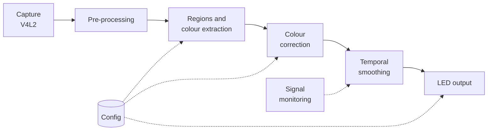

# Ambilight

A home-built Ambilight on a Raspberry Pi 3 B+: the TV picture is captured through an analogue USB grabber, the edge
colours are computed, and they are meant to drive an LED strip behind the TV in real time. No existing Ambilight
framework (such as Hyperion) is used; the pipeline is written from scratch. Hardware access and numerics may use
libraries.

> **Project status: work in progress.** Capture works and was verified. The LED output is not working yet and the
> processing pipeline is not implemented. See [Status](#status) for exactly what exists. Photo / GIF of the finished
> build: to be added by the owner.

## Status

| # | Milestone | State |
|---|---|---|
| M0 | Repository and one-command deploy | Done |
| M1 | Capture verified (colour frame from the right input) | Done: colour NTSC frame captured and checked against the TV |
| M2 | LEDs verified (pin, type, colour order, count, layout, power budget) | **In progress, blocked.** Power budget and layout documented, the Pi produces a correct WS2812B signal, but no LED has lit yet |
| M3 | Pipeline MVP (edge colours on the LEDs in real time) | Not started |
| M4 | Picture quality (letterbox detection, smoothing, colour correction) | Not started |
| M5 | Robustness (no-signal handling, grabber reconnect, systemd service, clean shutdown) | Not started |
| M6 | Measurement and documentation (benchmarks, complete docs) | Not started; documentation is in progress |

Known problems, in order of impact:

1. **LEDs do not react.** The signal on GPIO 18 has correct WS2812B timing (measured), but no LED lights, with
   800 or 400 kHz and 24 or 32 bit. Later GPIO 18 read back stuck high. Details and open steps:
   [docs/hardware.md](docs/hardware.md).
2. **The Pi reports under-voltage** with two cables and two power supplies, even at idle. The board is visibly bent.
   A replacement Pi 3 B+ was ordered. Until then no valid CPU or latency numbers exist
   ([docs/benchmarks.md](docs/benchmarks.md)).
3. **No colour in PAL.** The converter only delivers colour in its NTSC setting; PAL gives a black-and-white picture.
   The setup therefore runs NTSC ([ADR-004](docs/decisions.md)).

## Hardware

| Component | Details |
|---|---|
| Computer | Raspberry Pi 3 Model B+ (4x Cortex-A53, 1 GB RAM), Raspberry Pi OS Lite 64-bit |
| Splitter | Portta HDMI splitter 1x2 (N2SP12MD) |
| Converter | HDMI-to-AV converter with a PAL/NTSC switch (**set to NTSC**) |
| Grabber | CSL USB video grabber, Syntek STK1160 (`05e1:0408`) |
| LEDs | WS2812B-type strip, 5 V, 109 LEDs (17 + 17 bottom with a one-LED gap, 20 right, 35 top, 20 left) |
| LED supply | 5 V / 10 A (50 W) |

Signal chain:

```
Source -> HDMI splitter -> TV
                        -> HDMI-to-AV converter -> composite -> USB grabber -> Pi -> data line -> LED strip
```

The analogue composite link is the hard limit for picture quality and frame rate: 720x480, interlaced, about 29.97
frames per second. Wiring, pin assignment and the power calculation are in [docs/hardware.md](docs/hardware.md).

## Architecture



Each stage is meant to be a separate module behind a narrow interface, with metrics, logging and a systemd service
around it. The full description with the status of every stage is in [docs/architecture.md](docs/architecture.md).
Only the capture path exists today, as manual commands and helper tools.

## Repository layout

```
ambilight/
├── src/          # pipeline modules (empty so far)
├── config/       # example configuration
├── tools/        # helper scripts: frame capture, LED test patterns, GPIO measurements
├── tests/        # unit and replay tests (empty so far)
├── deploy/       # deploy and Pi setup scripts
└── docs/         # architecture, decision log (ADR), benchmarks, hardware, ideas
```

## Setup and deploy

Prerequisites: a Raspberry Pi 3 B+ with Raspberry Pi OS Lite 64-bit, SSH key login, and the hardware above.

1. **SSH alias on the Mac.** Add to `~/.ssh/config` (nothing host-specific lives in the repository):

   ```
   Host ambilight
       HostName <address of your Pi>
       User <your user>
   ```

2. **Deploy the project** to `~/ambilight` on the Pi:

   ```bash
   deploy/deploy.sh
   ```

   `AMBILIGHT_HOST` overrides the alias. The script uses `rsync --delete`, so do not keep hand-made files in
   `~/ambilight` on the Pi (the `.venv` folder is excluded).

3. **Prepare the Pi** (needs `sudo`; run it on the Pi, it asks for the password):

   ```bash
   ~/ambilight/deploy/setup.sh
   sudo reboot
   ```

   It installs the packages, switches analogue audio off (it claims the PWM block used for GPIO 18), makes the
   systemd journal persistent and creates a Python virtual environment with `rpi_ws281x`. Every system change is
   listed in [docs/hardware.md](docs/hardware.md#system-changes-on-the-pi).

4. **Set the converter switch to NTSC.**

5. **Check the Pi's power state.** It should read `throttled=0x0`:

   ```bash
   ssh ambilight vcgencmd get_throttled
   ```

## Tools

Capture one frame (runs on the Mac, uses SSH, writes a PNG and prints luma and chroma statistics). A colour picture
has chroma well above 0; an exact 0.00 means the picture is black and white:

```bash
tools/capture_frame.sh captures/frame.png
```

Defaults are input 0, standard `ntsc-m`, 720x480; they can be overridden with `AMBILIGHT_INPUT`, `AMBILIGHT_STD`,
`AMBILIGHT_W` and `AMBILIGHT_H`. The `captures/` folder is git-ignored.

LED test patterns (run on the Pi, as root; **hard limits: brightness 32 of 255, at most 8 LEDs lit, everything off on
exit**):

```bash
sudo ~/ambilight/.venv/bin/python ~/ambilight/tools/led_test.py color --index 0 --brightness 10
sudo ~/ambilight/.venv/bin/python ~/ambilight/tools/led_test.py mark --index 0 --count 5 --brightness 32
```

Other modes and options: `walk`, `off`, `--stream`, `--freq`, `--rgbw`, `--pin`; see the header of
[tools/led_test.py](tools/led_test.py). Measure whether a GPIO pin is being driven, without root:

```bash
~/ambilight/.venv/bin/python ~/ambilight/tools/gpio_sample.py 18 1
gcc -O2 -o /tmp/gpio_pulse ~/ambilight/tools/gpio_pulse.c && /tmp/gpio_pulse 18
```

**LED safety:** 109 LEDs can draw 6.5 A at full white. Never drive all LEDs at full white without a current limit
in place. The production pipeline will have one; the test tool simply refuses to light more than 8 LEDs.

## Key numbers

There are no valid performance numbers yet, and none are claimed. What has been measured, and how far it can be
trusted, is in [docs/benchmarks.md](docs/benchmarks.md). The target figures (frame rate, end-to-end latency, CPU
load) will be added here once they are measured on a healthy Pi.

## Documentation

| Document | Content |
|---|---|
| [docs/architecture.md](docs/architecture.md) | target architecture, data flow, stage status, constraints |
| [docs/decisions.md](docs/decisions.md) | decision log (ADR), including failed and revised attempts |
| [docs/hardware.md](docs/hardware.md) | components, wiring, power calculation, investigation logs, system changes |
| [docs/benchmarks.md](docs/benchmarks.md) | measurement method and results |
| [docs/ideas.md](docs/ideas.md) | extensions that are not planned |

## How this project was made

The project idea, the choice and assembly of the hardware, and the project steering are by the owner, Finn
Blechschmidt. The implementation and the technical decisions (capture settings, tooling, deploy approach, test
methods) were made with AI assistance, using Claude Code. All decisions, including mistakes and reversals, are
recorded in [docs/decisions.md](docs/decisions.md). Examples are the PAL assumption that had to be reversed
(ADR-004) and a deploy script that deleted the virtual environment on the Pi (ADR-001 amendment).

## License

MIT, see [LICENSE](LICENSE).
