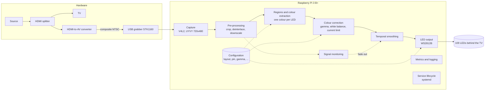

# Architecture

This document describes the **target architecture**. At the time of writing only the capture path and a set of
hardware test tools exist; the pipeline stages are not implemented yet. The status column says which is which.

## Data flow

## Stages and status

| Stage | Responsibility | Status |
|---|---|---|
| Capture | Read frames from the grabber through V4L2, set input/standard/format, reconnect on device loss | Manual only: `v4l2-ctl` commands and `tools/capture_frame.sh` (ADR-002, ADR-004). No in-process capture code |
| Pre-processing | Downscale, handle interlacing, crop overscan borders, detect and ignore letterbox bars | Not started. The captured frames show about 8 px black borders and interlacing combing |
| Regions and colour extraction | One picture region per LED along the edge (from the layout), one representative colour per region (mean, median, weighted, dominant, to be decided and measured) | Layout and mean colour per region implemented (`src/ambilight/layout.py`, `extract.py`), 26 unit tests on the Mac. Median/weighted variants and timing on the Pi are open |
| Colour correction | Gamma, white balance, brightness limit, **current limit** matched to the supply | Gamma, brightness and current limit implemented (`color.py`) and unit-tested. White balance/calibration open (needs the real strip) |
| Temporal smoothing | No flicker without feeling sluggish; fast reaction to scene cuts | Implemented (`smoothing.py`, [ADR-008](decisions.md)), unit-tested; parameters not tuned on real LEDs |
| LED output | Drive the WS2812B strip (pin, colour order and count from the config) | Provisional method decided ([ADR-005](decisions.md)); no LED has lit yet ([hardware.md](hardware.md)) |
| Signal monitoring | Detect no signal, a frozen picture or the converter's "NO SIGNAL" pattern and fade the LEDs out | Detection implemented (`monitor.py`, [ADR-009](decisions.md)) and unit-tested, including against the real PAL pattern; the NTSC pattern and live noise are unverified |
| Configuration | One file for the LED layout, pin, gamma, brightness, smoothing, no magic numbers in code | Implemented: validated TOML loading (`config.py`), example in `config/ambilight.example.toml` |
| Metrics and logging | fps, per-stage latency, CPU load, retrievable without a debugger | Not started |
| Service | systemd unit, autostart, clean shutdown with all LEDs off | Not started. The test tool already switches the LEDs off on exit |

## Constraints that shape the design

- **Source quality.** Composite NTSC, interlaced, 720x480, about 29.97 frames per second (59.94 fields). Chroma is
  band-limited and shows colour fringing. Edge colours averaged over a region are far less affected than a picture
  would be.
- **Frame interval.** At about 29.97 fps a new frame arrives every 33.4 ms. The end-to-end latency budget has not been
  measured yet; the target is no perceptible offset between the TV picture and the LEDs.
- **CPU.** A Pi 3 B+ has four Cortex-A53 cores. The goal is a clear CPU reserve in continuous operation, with no
  throttling. This must be measured on a healthy Pi ([benchmarks.md](benchmarks.md)).
- **LED output timing.** WS2812B needs about 1.25 us per bit. The frame for 109 LEDs is 109 x 24 bits, roughly 3.3 ms
  on the wire, which allows far more than the capture rate.
- **Power.** 109 LEDs can draw 6.5 A at full white. The code must enforce a current limit; see
  [hardware.md](hardware.md).
- **Language and concurrency model** are deliberately undecided. They will be chosen from measurements on a healthy
  Pi and recorded as ADRs ([ADR-003](decisions.md)).

## Layout and region mapping (planned)

The strip has 109 LEDs: bottom 17 + gap of one LED + 17, right 20, top 35, left 20. LED 0 sits right of the gap at
the bottom centre. The mapping from LED index to screen edge region depends on the direction of travel, which is
verified in M2 with a test pattern. The layout belongs in the configuration, not in code.

## Interfaces (planned)

Each stage is a separate module with a narrow interface:

| Between | Data |
|---|---|
| Capture -> Pre-processing | raw frame, UYVY 720x480, with a timestamp |
| Pre-processing -> Regions | cropped, downscaled picture |
| Regions -> Colour correction | list of 109 colours (RGB) |
| Colour correction -> Smoothing | 109 corrected colours |
| Smoothing -> LED output | 109 final colours; the output applies colour order and writes the frame |

Replay tests will feed recorded frames through the stages without any hardware.

## Tools that exist today

| Tool | Purpose |
|---|---|
| `deploy/deploy.sh` | rsync the project to the Pi |
| `deploy/setup.sh` | prepare a fresh Pi OS Lite (packages, audio off, venv) |
| `tools/capture_frame.sh` | capture one frame on the Pi, convert on the Mac, print luma/chroma statistics |
| `tools/uyvy2png.py` | dependency-free UYVY to PNG converter |
| `tools/led_test.py` | LED test patterns with hard safety limits |
| `tools/gpio_sample.py`, `tools/gpio_pulse.c` | measure activity and pulse widths on a GPIO pin without root |
